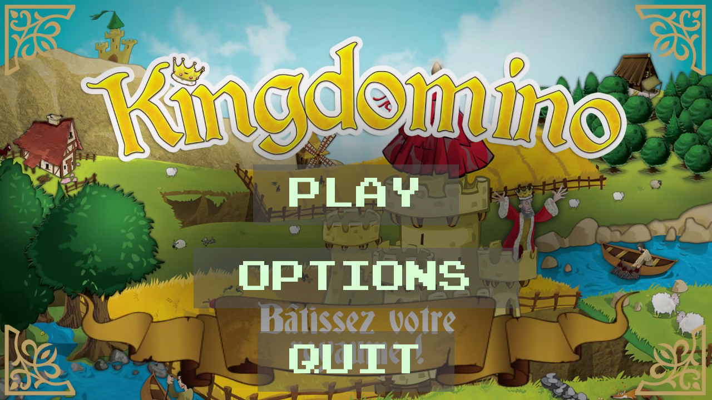
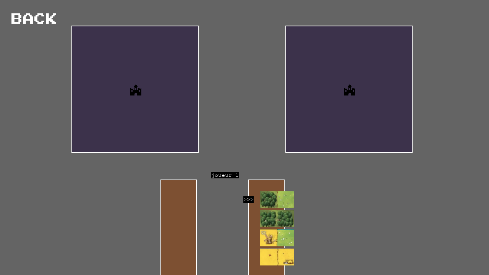

# Kingdomino in Pygame

A two-player version of the Kingdomino board game, written in Python with Pygame.
It was my first Python project, an individual assignment of the Python course in
the integrated preparatory cycle at EILCO (Université du Littoral Côte d'Opale),
October 2022. Comments in the code are in French.

## What is implemented

- The 48 dominoes of the base game, listed in `params.py` as pairs of terrain
  letters (C wheat field, B forest, E water, P grassland, M swamp, F mine) with
  one `+` per crown. At start-up 24 of them are drawn at random, which is the
  number used in a two-player game.
- A main menu (Play / Options / Quit) with a background image, a music loop and
  a click sound on the buttons.
- The play screen: the two territories with a castle in the middle, the two
  domino tables, and the current draw of four dominoes.
- The selection phase: a `>>>` cursor moves along the four dominoes with the
  Down arrow and Enter picks one. Player 1 picks two dominoes, then player 2
  takes the other two; the picks are tagged R1 / R2 on screen.
- The placement phase: the chosen domino is moved with the arrow keys, rotated
  with Space and dropped with Enter. It can only be dropped on a few hard-coded
  cells next to the castle.

## Running it

Python 3 and Pygame are the only requirements.

    pip install -r requirements.txt
    python main.py

Run it from the repository root: asset and music paths are relative.

## Files

    main.py           screens, selection and placement logic
    button.py         clickable text button used by the menu
    dominos_liste.py  loads the domino images and draws the random set of 24
    params.py         game constants: terrain colours, the 48 dominoes, screen size
    assets/           domino images, castle, menu background and button frames
    music/            intro loop and button sounds

## Limitations

- No scoring: `Cellule` carries the crown count and a "counted" flag, but the
  area computation is not implemented.
- Placement does not check terrain matching, and only the first draw of four
  dominoes is played through; the loop over the full 24-domino game is missing.
- The Options screen only has a Back button.

## Credits

Kingdomino is a board game by Bruno Cathala, published by Blue Orange. This is
a student re-implementation and is not affiliated with them. The data model
(`Params`, `Cellule`, `Domino`, `Oriente`) follows the skeleton handed out in
the course. The `Button` class and the three menu button frames are adapted
from the baraltech Pygame menu tutorial.
