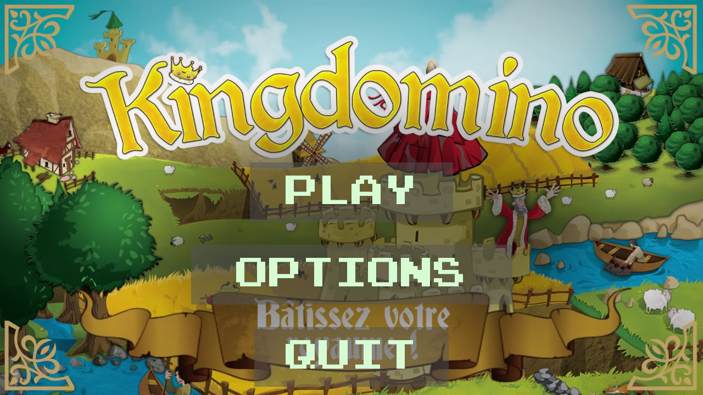
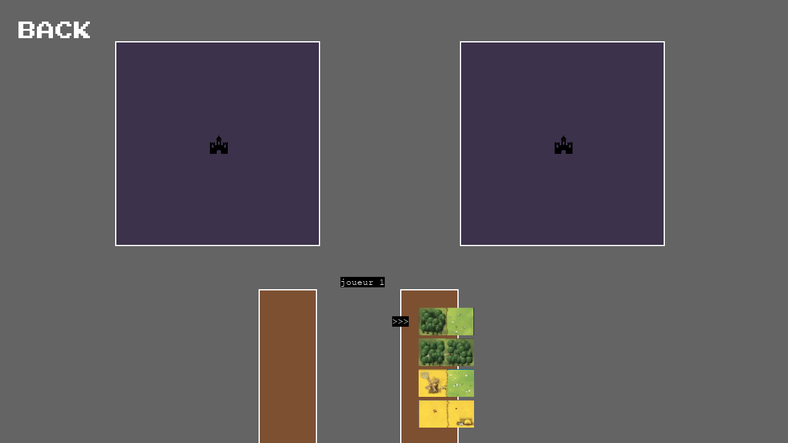

# Kingdomino in Pygame

Two-player version of the Kingdomino board game, written in Python with Pygame. The players draft dominoes from a shared draw of four and place them on their own territory around a castle. The 48 dominoes of the base game are described as data and drawn as images at start-up.



## What it does

- Loads the 48 dominoes of the base game from `params.py`, then draws the 24 used in a two-player game. Each domino is a pair of terrain letters (C wheat field, B forest, E water, P grassland, M swamp, F mine) with one `+` per crown.
- Main menu (play / options / quit) with a background image, a music loop and a click sound on the buttons.
- Play screen with the two territories, a castle in the middle of each, the two domino tables and the current draw of four dominoes.
- Selection phase: a `>>>` cursor moves with the down arrow and Enter picks. Player 1 takes two dominoes, player 2 the other two, tagged R1 / R2 on screen.
- Placement phase: the arrow keys move the chosen domino, Space rotates it and Enter drops it on a few hard-coded cells next to the castle.



## How it works

```
main.py           screens, selection and placement logic (Ecran, Oriente, Cellule, Domino)
button.py         clickable text button used by the menu
dominos_liste.py  loads the domino images and draws the random set of 24
params.py         game constants: terrain colours, the 48 dominoes, screen size
assets/           domino images, castle, menu background and button frames
music/            intro loop and button sounds
```

## Run it

Python 3 and Pygame. Run from the repository root, because asset and music paths are relative.

```bash
pip install -r requirements.txt
python main.py
```

## Limitations

- No scoring: `Cellule` carries the crown count and a counted flag, but the area computation is not implemented.
- Placement does not check terrain matching, and only the first draw of four is played. The loop over the full 24-domino game is missing.
- The options screen only has a back button.

Individual assignment of the Python course in the integrated preparatory cycle at EILCO (Université du Littoral Côte d'Opale), October 2022. It was my first Python project and the comments in the code are in French. Kingdomino is a board game by Bruno Cathala published by Blue Orange, with no affiliation. The data model (`Params`, `Cellule`, `Domino`, `Oriente`) follows the skeleton handed out in the course. The `Button` class and the three menu button frames are adapted from the baraltech Pygame menu tutorial.
